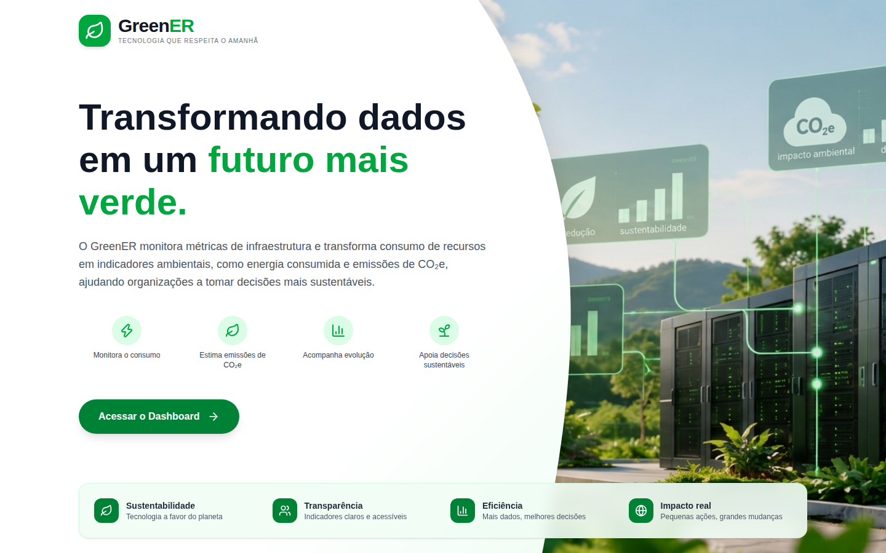
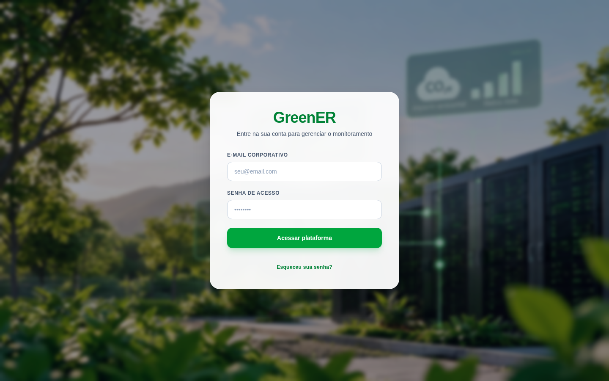
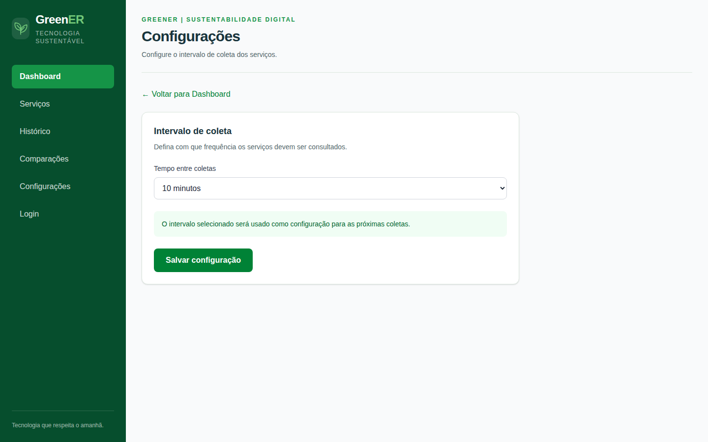
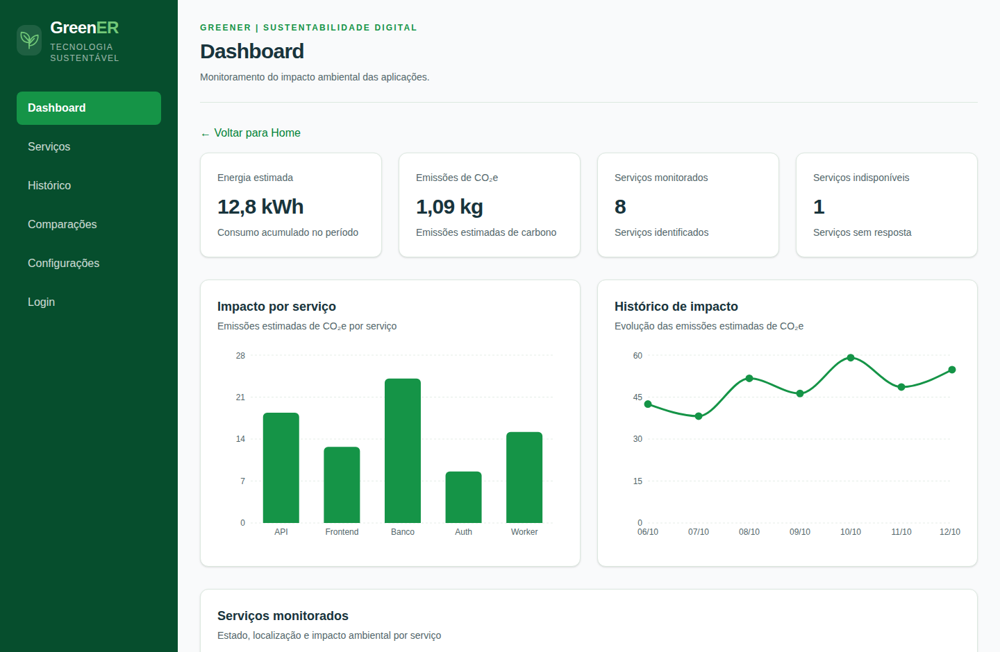
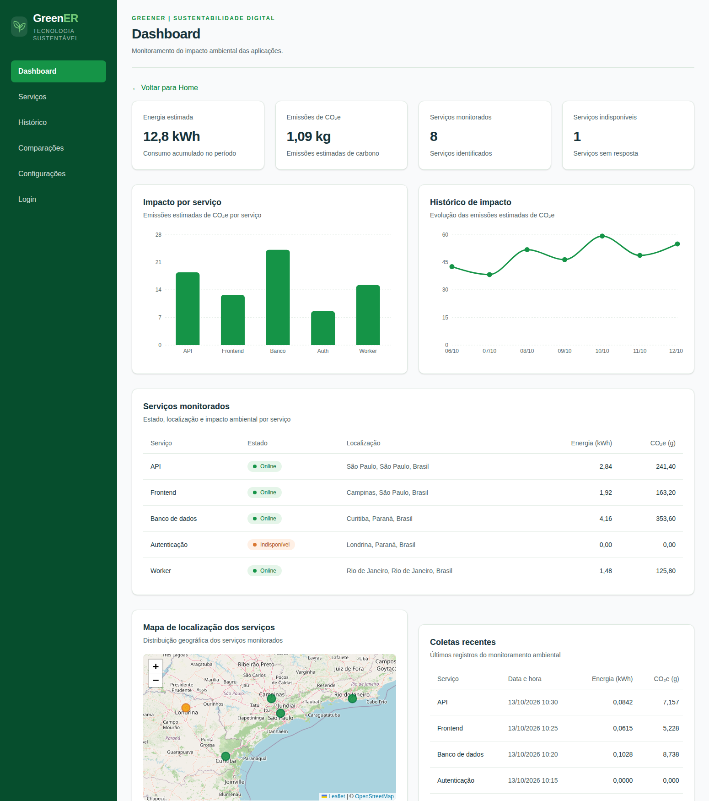

# ATIVIDADE SOBRE UI (User Interface) e UX (User Experience)

**EM GRUPO – ATIVIDADE DO DIA 13/10/2026.**  
**EQUIPE:** DEVMASTER  
**INTEGRANTES:** Caio Julião, Jocelio Gomes Silva, Lucas dos Santos Ribeiro, Luis Gustavo, Ricardo Ladeira e Victor Ramos  
**PROJETO DE REFERÊNCIA (PRINTS):** GreenER — Plataforma de Monitoramento de Impacto Ambiental de Software  

---

## 1.- Definir UI, objetivos e citar os principais pontos (aspectos) que devem estar presentes no UI.

### Definição de UI (User Interface / Interface do Usuário)
A **UI (User Interface)** é a camada visual, gráfica e interativa por meio da qual uma pessoa interage com um sistema, software, aplicativo ou dispositivo digital. Ela compreende todos os elementos tangíveis na tela — como botões, menus, tipografia, paleta de cores, ícones, formulários, tabelas, cards e gráficos — que traduzem as funcionalidades técnicas do sistema em controles compreensíveis para o usuário.

### Objetivos do UI Design
1. **Facilitar a interação visual:** Tornar evidente o que pode ser clicado, preenchido ou navegado (*affordance* visual).
2. **Guiar a atenção do usuário:** Estabelecer uma hierarquia visual clara para que o usuário encontre rapidamente as informações mais importantes.
3. **Transmitir a identidade da marca:** Comunicar visualmente o propósito do produto por meio de cores, fontes e estilo gráfico coerentes.
4. **Minimizar o esforço visual e de leitura:** Apresentar dados complexos de forma limpa, organizada e agradável.

### Principais pontos (aspectos) que devem estar presentes no UI
* **Hierarquia Visual:** Organização dos elementos por tamanho, peso da fonte, cor e posicionamento (ex.: títulos em destaque, valores numéricos maiores que legendas).
* **Consistência e Padronização:** Uso uniforme de componentes, bordas arredondadas, espaçamentos e comportamentos de botões em todas as telas da aplicação.
* **Tipografia Legível:** Escolha de fontes adequadas para leitura em tela (como a família *Inter* usada no GreenER), com bom contraste e tamanhos proporcionais para títulos, subtítulos e corpo de texto.
* **Paleta de Cores Semântica:** Uso intencional das cores para transmitir identidade e estados do sistema (ex.: tons de verde para sustentabilidade e status *Online*, laranja/âmbar para alertas de *Indisponível* e vermelho para erros).
* **Layout, Grid e Espaçamento (Respiro Visual / *Whitespace*):** Alinhamento estruturado em grades (*grids*) e margens bem definidas entre cards para evitar poluição visual.
* **Feedback Visual Imediato:** Mudança de cor ao passar o mouse (*hover*), destaque de foco nos campos de formulário (*focus ring*) e indicadores de carregamento (*spinners*).

### Aplicação prática no Frontend do projeto GreenER
Na Landing Page do **GreenER** (Figura 1), esses aspectos de UI ficam evidentes na combinação da paleta verde institucional (`#159447` e `#064E2D`), na tipografia com forte hierarquia no título principal, nos ícones vetoriais circulares que sintetizam as funcionalidades e no botão de chamada para ação (*Call to Action* — "Acessar o Dashboard") com sombra e destaque visual.

*Figura 1 — Landing Page do GreenER (`/`): hierarquia tipográfica, paleta de cores sustentável, ícones semânticos e botão de ação principal.*

---

## 2.- Definir UX e citar as fases do processo de design UX e explanar cada uma delas.

### Definição de UX (User Experience / Experiência do Usuário)
A **UX (User Experience)** engloba toda a jornada, percepção, emoção e eficiência que uma pessoa vivencia antes, durante e após interagir com um produto ou serviço. Enquanto a UI foca na superfície visual da tela, a UX foca na **resolução do problema do usuário**: se o fluxo faz sentido, se a arquitetura da informação é lógica, se a tarefa é cumprida sem frustração e se o sistema gera valor real.

### Fases do processo de Design UX
1. **Pesquisa e Imersão (*Research / Discover*):**
   * **Explicação:** Fase inicial voltada a compreender profundamente quem são os usuários (personas), quais são suas dores, necessidades, contexto de uso e objetivos do negócio. Envolve entrevistas, questionários, *benchmarking* e análise de requisitos.
   * **No GreenER:** Identificação da necessidade de equipes de TI e gestores acompanharem o consumo energético (kWh) e a pegada de carbono ($\text{CO}_2\text{e}$) de microsserviços sem precisar analisar logs brutos no terminal.
2. **Definição e Arquitetura da Informação (*Define*):**
   * **Explicação:** Consolidação dos dados da pesquisa para definir os fluxos de navegação (*User Flows*), a estrutura dos menus, a organização das informações em cada página e a priorização das funcionalidades essenciais (*MVP*).
   * **No GreenER:** Estruturação da navegação lateral fixa (`Sidebar`) dividindo a aplicação em áreas lógicas: *Dashboard*, *Serviços*, *Histórico*, *Comparações*, *Configurações* e *Login*.
3. **Ideação (*Ideate*):**
   * **Explicação:** Geração de ideias e alternativas de solução para os problemas mapeados. Aqui são feitos esboços rápidos (*sketches*) e *wireframes* de baixa fidelidade para decidir a melhor forma de exibir os dados (ex.: decidir entre mostrar emissões em tabela, gráfico de barras, gráfico de linha ou mapa geográfico).
4. **Prototipação (*Prototype*):**
   * **Explicação:** Construção de versões tangíveis e navegáveis da interface (de média a alta fidelidade em ferramentas como Figma, ou protótipos funcionais em código com dados simulados) para validar a interação e a disposição visual antes da integração final.
   * **No GreenER:** Implementação das telas em Next.js alimentadas inicialmente por `mockDashboard.ts`, permitindo visualizar e interagir com os cards, gráficos e mapas antes do acoplamento definitivo com todas as rotas da API.
5. **Testes e Iteração (*Test & Iterate*):**
   * **Explicação:** Avaliação do protótipo ou sistema com usuários reais para identificar gargalos de navegação, dúvidas de interpretação ou erros de fluxo, seguida do refinamento contínuo da interface com base no aprendizado obtido.

---

## 3.- Defina acessibilidade e como impacta no design de UI/UX.

### Definição de Acessibilidade Digital
A **acessibilidade** (frequentemente abreviada como *a11y* e norteada pelas diretrizes internacionais **WCAG — Web Content Accessibility Guidelines**) é a prática de projetar interfaces e sistemas digitais para que possam ser percebidos, compreendidos, navegados e operados por **qualquer pessoa**, incluindo pessoas com deficiências visuais (cegueira, baixa visão, daltonismo), auditivas, motoras, cognitivas ou limitações temporárias e ambientais.

### Como a acessibilidade impacta no design de UI/UX
* **Contraste de Cores e Independência Cromática:** O design não pode depender exclusivamente da cor para transmitir uma informação crítica. No **GreenER**, por exemplo, o estado de um serviço na tabela não usa apenas um ponto verde ou laranja: ele exibe uma *badge* com alto contraste textual escrito **"Online"** ou **"Indisponível"**, garantindo que usuários daltônicos compreendam imediatamente o status.
* **HTML Semântico e Suporte a Leitores de Tela (WAI-ARIA):** O código da interface deve usar tags semânticas (`<main>`, `<aside>`, `<nav>`, `<header>`, `<section>`, `<table>`) e atributos ARIA para que leitores de tela (como NVDA ou VoiceOver) anunciem corretamente a estrutura da página.
  * *Exemplo real no código do GreenER:* Na tela de Login (`src/app/login/page.tsx`), as mensagens dinâmicas utilizam `role="alert"` (para erros) e `role="status"` (para confirmação de redirecionamento), além de `<label htmlFor="email">` explicitamente vinculado ao `<input id="email">`. Na `Sidebar`, utiliza-se `<nav aria-label="Menu principal">` e `aria-current="page"`.
* **Navegação por Teclado e Foco Visível:** Usuários que não utilizam mouse precisam navegar via tecla `Tab`. Por isso, todos os inputs e seletores do GreenER possuem classes `focus:ring-4 focus:ring-green-100 focus:border-green-600`, desenhando um contorno claro no elemento ativo.

*Figura 2 — Tela de Login do GreenER (`/login`): uso de rótulos explícitos (`label`), alto contraste sobre fundo desfocado (`backdrop-blur`), estados de foco e alertas acessíveis com atributos `role="alert"` e `role="status"`.*

---

## 4.- Defina "usabilidade" no UX.

### Definição de Usabilidade
A **usabilidade** é um atributo de qualidade dentro da UX que mede **o quão fácil, intuitiva, eficiente e livre de erros é a utilização de uma interface** por um usuário ao tentar realizar uma tarefa específica. Segundo a norma **ISO 9241-11** e as heurísticas de **Jakob Nielsen**, a usabilidade apoia-se em 5 pilares fundamentais:

1. **Facilidade de Aprendizado (*Learnability*):** Quão rápido um usuário que nunca viu o sistema consegue entender como realizar as tarefas básicas.
2. **Eficiência (*Efficiency*):** Depois que o usuário aprendeu a usar o sistema, quão rapidamente ele consegue executar suas tarefas diárias.
3. **Memorabilidade (*Memorability*):** Quando o usuário retorna ao sistema após um período sem usá-lo, quão fácil é lembrar como ele funciona.
4. **Prevenção e Tolerância a Erros (*Errors*):** Quantos erros o usuário comete, quão graves são e quão facilmente o sistema o ajuda a evitá-los ou se recuperar deles.
5. **Satisfação (*Satisfaction*):** Quão agradável e confortável é utilizar o design.

### Exemplo de Usabilidade no Frontend do GreenER
Na tela de **Configurações** do GreenER (`src/app/configuracoes/page.tsx` — Figura 3), em vez de obrigar o usuário a digitar manualmente um número ou uma expressão complexa de agendamento (*cron*) para o intervalo de coleta — o que poderia gerar erros de digitação, valores negativos ou inválidos —, a interface oferece um componente `<select>` fechado com opções pré-validadas (*1, 5, 10, 15, 30 e 60 minutos*), acompanhado de um aviso explicativo em destaque verde claro e um botão direto **"Salvar configuração"**. Isso reduz a carga cognitiva e previne erros operacionais.

*Figura 3 — Tela de Configurações do GreenER (`/configuracoes`): exemplo de usabilidade com seleção guiada de intervalo de coleta, texto de apoio claro e caminho de retorno visível ("← Voltar para Dashboard").*

---

## 5.- Defina "design centrado no usuário" e cite a diferença com outras abordagens de design.

### Definição de Design Centrado no Usuário (DCU / *User-Centered Design — UCD*)
O **Design Centrado no Usuário (DCU)** é uma filosofia e abordagem metodológica de projeto em que as necessidades, características, limitações cognitivas e objetivos dos **usuários finais** são colocados no centro de todas as etapas de decisão do desenvolvimento de um produto (desde a concepção até a implementação e validação). No DCU, a tecnologia se adapta à forma como o ser humano pensa e trabalha, e não o contrário.

### Diferenças entre o Design Centrado no Usuário e outras abordagens de design

| Critério | Design Centrado no Usuário (DCU) | Design Centrado no Sistema / Tecnologia | Design Centrado no Negócio / Autor |
| :--- | :--- | :--- | :--- |
| **Foco Principal** | Resolver a dor real do usuário com o menor esforço cognitivo possível. | Expor a estrutura do banco de dados, APIs ou capacidades técnicas do código. | Atender apenas metas comerciais imediatas ou o gosto pessoal do criador/gestor. |
| **Tomada de Decisão** | Baseada em pesquisas, observação de uso, personas e testes de usabilidade. | Baseada no que é mais fácil ou rápido para o desenvolvedor programar. | Baseada em opiniões internas (*"achismos"*) ou estética isolada de função. |
| **Apresentação de Dados** | Traduz dados brutos em **indicadores visuais acionáveis** (cards, gráficos, mapas). | Exibe tabelas cruas, códigos de status técnicos ou logs difíceis de interpretar. | Prioriza elementos promocionais que muitas vezes atrapalham a tarefa principal. |
| **Tratamento de Erros** | Mensagens em linguagem humana e orientação clara de como corrigir. | Mensagens técnicas de exceção (ex.: `Error 500` ou falha de SQL). | Frequentemente negligenciado em prol do "caminho feliz". |

* **Exemplo prático no GreenER:** Uma abordagem *centrada apenas no sistema* entregaria um JSON bruto do Worker com métricas de CPU e rede. Já a abordagem *centrada no usuário* adotada no Dashboard do GreenER (Figura 4) converte automaticamente esses cálculos em 4 cards executivos no topo (**Energia estimada: 12,8 kWh**, **Emissões de $\text{CO}_2\text{e}$: 1,09 kg**, **Serviços monitorados: 8**, **Serviços indisponíveis: 1**), permitindo que um gestor ou engenheiro entenda a saúde ambiental da infraestrutura em poucos segundos.

*Figura 4 — Topo do Dashboard do GreenER (`/dashboard`): dados técnicos do Worker traduzidos em indicadores executivos (cards) e gráficos comparativos imediatos.*

---

## 6.- Defina "testes de usabilidade" e como estão presentes no processo de UX.

### Definição de Testes de Usabilidade
Os **testes de usabilidade** são sessões estruturadas de avaliação em que usuários reais (representantes do público-alvo) são convidados a utilizar um protótipo ou sistema funcional para cumprir tarefas específicas (cenários), enquanto avaliadores observam seu comportamento, tempo de execução, cliques, dúvidas e dificuldades. **O objetivo nunca é "testar o usuário", mas sim testar a interface** para descobrir onde ela falha em comunicar sua função.

### Como os testes de usabilidade estão presentes no processo de UX
Eles atuam como o **mecanismo de validação contínua** ao longo do ciclo de UX:
1. **Planejamento do Teste:** Define-se o objetivo e as tarefas (ex.: *"Imagine que você precisa descobrir qual serviço emite mais $\text{CO}_2\text{e}$ hoje, verificar em qual cidade está o serviço indisponível e alterar o tempo de coleta para 5 minutos"*).
2. **Execução com Protocolo *Think Aloud* (Pensar em Voz Alta):** O participante executa a tarefa no frontend narrando o que está pensando e procurando na tela, revelando se os rótulos do menu e os gráficos estão claros.
3. **Coleta de Métricas Qualitativas e Quantitativas:** Mede-se a **taxa de sucesso** da tarefa, o **tempo gasto**, o **número de cliques equivocados** e a **percepção subjetiva** de dificuldade.
4. **Identificação de Pontos de Atrito e Refinamento:** Caso os usuários demorem para encontrar como voltar à tela inicial ou não percebam quando um formulário está carregando, a equipe de UX/Frontend ajusta a interface (como a inclusão do link `"← Voltar para Home"` no topo do Dashboard e do texto `"Acessando..."` com ícone giratório no botão de Login do GreenER).

---

## 7.- Tipos de Imagens que podem ser utilizadas no UI/UX

No design de interfaces modernas, diferentes formatos e categorias de imagens desempenham funções estéticas, informativas e funcionais distintas:

1. **Fotografias (*Imagens Rasterizadas / Bitmap* — `.jpg`, `.png`, `.webp`, `.avif`):**
   * Utilizadas em *Hero Sections* e planos de fundo para criar contexto emocional, realismo e conexão imediata com o tema do produto.
   * **Exemplo no GreenER:** O arquivo `/public/green-datacenter.jpg`, utilizado como imagem de destaque na direita da Landing Page (Figura 1) e como plano de fundo suavizado na tela de Login (Figura 2), associando servidores de datacenter à natureza.
2. **Ícones Vetoriais (*Scalable Vector Graphics* — `.svg`):**
   * Imagens baseadas em vetores matemáticos que não perdem qualidade em nenhuma resolução de tela (Retina/4K), possuem tamanho de arquivo mínimo e auxiliam no reconhecimento rápido de funções sem exigir leitura extensa.
   * **Exemplo no GreenER:** Uso da biblioteca **Lucide React** (`Zap`, `Leaf`, `BarChart3`, `Sprout`, `Users`, `Globe`, `ArrowRight`) na Landing Page e o logotipo em SVG customizado de folha na `Sidebar` (`src/components/layout/Sidebar.tsx`).
3. **Elementos Gráficos Decorativos e Formas Vetoriais:**
   * Formas orgânicas, divisores de seção e gradientes em SVG que estruturam o layout.
   * **Exemplo no GreenER:** A curva orgânica em SVG com gradiente linear (`#ffffff` para `#f0fdf4`) na Landing Page (`src/app/page.tsx`), que separa suavemente o bloco de leitura à esquerda da fotografia à direita.
4. **Gráficos de Visualização de Dados (*Data Visualization* em SVG/Canvas):**
   * Representações visuais dinâmicas geradas a partir de dados numéricos (gráficos de barras, linhas, áreas).
   * **Exemplo no GreenER:** Os componentes `ImpactoPorServico.tsx` (gráfico de barras `<BarChart>`) e `HistoricoImpacto.tsx` (gráfico de linhas `<LineChart>`) renderizados em SVG responsivo pela biblioteca **Recharts**.
5. **Mapas Interativos baseados em *Tiles* e Marcadores Geográficos:**
   * Camadas de imagens cartográficas combinadas com vetores interativos para localização espacial.
   * **Exemplo no GreenER:** O componente `MapaServicosLeaflet.tsx` (Figura 5), que renderiza os *tiles* do **OpenStreetMap** com marcadores circulares (`CircleMarker`) verdes (serviços *Online* em São Paulo, Campinas, Curitiba e Rio de Janeiro) e laranja (serviço *Indisponível* em Londrina).

*Figura 5 — Dashboard completo do GreenER (`/dashboard`): combinação de ícones SVG na barra lateral, gráficos vetoriais Recharts (barras e linha), badges semânticas em tabelas e mapa interativo Leaflet/OpenStreetMap.*

---

## 8.- Importância de UI/UX no Desenvolvimento de Produtos.

O design de UI/UX deixou de ser uma etapa meramente estética ao final do projeto para se tornar um **pilar estratégico desde a concepção do software**, pelos seguintes motivos:

* **Ponte entre Engenharia Complexa e Valor Humano:** Um sistema pode possuir um backend robusto (como o Worker do GreenER integrado ao PostgreSQL, Prisma e APIs de carbono), mas o usuário final interage exclusivamente com o frontend. Se a interface for confusa, todo o esforço de engenharia perde impacto prático.
* **Redução drástica de retrabalho no desenvolvimento:** Corrigir um problema de fluxo ou arquitetura de informação durante a fase de wireframe/protótipo custa muito menos tempo e dinheiro do que refatorar componentes, rotas e banco de dados após o software já estar codificado.
* **Adoção e Engajamento do Produto:** Produtos com boa UX exigem menos treinamento corporativo, têm menor taxa de rejeição (*churn*) e são adotados rapidamente pelas equipes.
* **Apoio à Tomada de Decisão Ágil:** Em sistemas de monitoramento e *dashboards* (como o GreenER), um bom projeto de UI/UX transforma dezenas de registros de telemetria em diagnósticos visuais imediatos, permitindo identificar em segundos qual serviço caiu ou qual aplicação está consumindo mais energia.
* **Alinhamento Multidisciplinar:** O processo de UI/UX alinha a visão do *Product Owner*, *Scrum Master* e *Desenvolvedores* (Frontend e Backend) em torno do mesmo objetivo de entrega a cada Sprint.

---

## 9.- Citar os benefícios de um bom UI/UX

Um projeto de UI/UX bem executado gera benefícios diretos tanto para quem utiliza quanto para a organização que desenvolve o software:

1. **Aumento da Produtividade e Eficiência Operacional:** O usuário encontra o que procura em poucos cliques, realizando tarefas em menos tempo.
2. **Redução da Carga Cognitiva:** Informações bem agrupadas (como a separação no GreenER entre *Indicadores Gerais*, *Gráficos Analíticos*, *Tabela de Estado* e *Mapa Geográfico*) evitam fadiga mental.
3. **Diminuição de Erros Humanos e Chamados de Suporte:** Interfaces autoexplicativas, com feedbacks claros e opções guiadas, reduzem dúvidas e tickets de suporte técnico.
4. **Maior Satisfação, Confiança e Credibilidade:** Um visual consistente, limpo e profissional transmite segurança e confiabilidade sobre os dados apresentados pela plataforma.
5. **Inclusão e Alcance Ampliado (Acessibilidade):** Permite que pessoas com diferentes habilidades visuais, motoras ou tecnológicas utilizem o sistema com autonomia.
6. **Maior Taxa de Conversão e Retenção:** Na Landing Page (Figura 1), uma proposta de valor clara aliada a um botão de ação evidente ("Acessar o Dashboard") conduz o visitante diretamente ao fluxo principal do produto.
7. **Escalabilidade Visual (*Design System*):** A criação de componentes reutilizáveis e padronizados (como `IndicadorCard.tsx`, `Header.tsx` e `Sidebar.tsx` no GreenER) acelera o desenvolvimento de novas telas nas próximas Sprints mantendo a identidade visual intacta.

---

## 10.- Cite as principais ferramentas utilizadas para criar protótipos de UI/UX.

As ferramentas de prototipação e design de UI/UX podem ser divididas entre ferramentas de **design visual/prototipação navegável**, **wireframing/fluxos** e **prototipação funcional em código**:

### A) Principais ferramentas de Design de Interface e Prototipação Interativa
1. **Figma (Padrão atual da indústria):** Ferramenta colaborativa em tempo real baseada na web para criação de *wireframes*, interfaces de alta fidelidade, *Design Systems*, variáveis/tokens de cor e protótipos interativos navegáveis.
2. **Penpot:** Principal plataforma *open-source* de design e prototipação baseada em padrões web abertos (SVG e CSS Grid/Flexbox), muito utilizada por equipes que integram design e código.
3. **Adobe XD:** Ferramenta da Adobe voltada à criação de layouts vetoriais e protótipos interativos com transições de tela.
4. **Sketch:** Ferramenta tradicional de design de interfaces vetoriais para ecossistema macOS, pioneira no uso de símbolos e bibliotecas de componentes.

### B) Ferramentas de Wireframing, Ideação e Fluxos de Usuário (UX)
5. **Miro / FigJam / Whimsical:** Quadros brancos colaborativos (*whiteboards*) usados nas fases de pesquisa, *brainstorming*, mapas de empatia, jornadas do usuário e fluxogramas de navegação (*User Flows*).
6. **Balsamiq Wireframes:** Focado em *wireframes* de baixa fidelidade (estilo rascunho à mão) para validar a estrutura e a usabilidade sem distrações estéticas.
7. **Framer / ProtoPie:** Ferramentas avançadas para protótipos de altíssima fidelidade com microinterações, animações reais e lógica condicional.

### C) Ferramentas e Tecnologias de Prototipação Funcional no Frontend (Utilizadas no GreenER)
No desenvolvimento do projeto **GreenER**, além do planejamento visual, a prototipação de alta fidelidade navegável foi materializada diretamente no frontend utilizando:
* **Next.js (React + TypeScript):** Estruturação das páginas (`/`, `/login`, `/dashboard`, `/configuracoes`) e componentização modular.
* **Tailwind CSS:** Prototipação ágil de estilos, cores (`#064E2D`, `#159447`, `#F7FAF7`), tipografia (*Inter*), *grids* responsivos e estados de interação (`hover`, `focus`, `active`).
* **Recharts, React-Leaflet e Lucide React:** Bibliotecas visuais para prototipação rica de gráficos analíticos, mapas interativos e iconografia, alimentadas durante a fase de protótipo pelos dados simulados em `src/data/mockDashboard.ts`.
