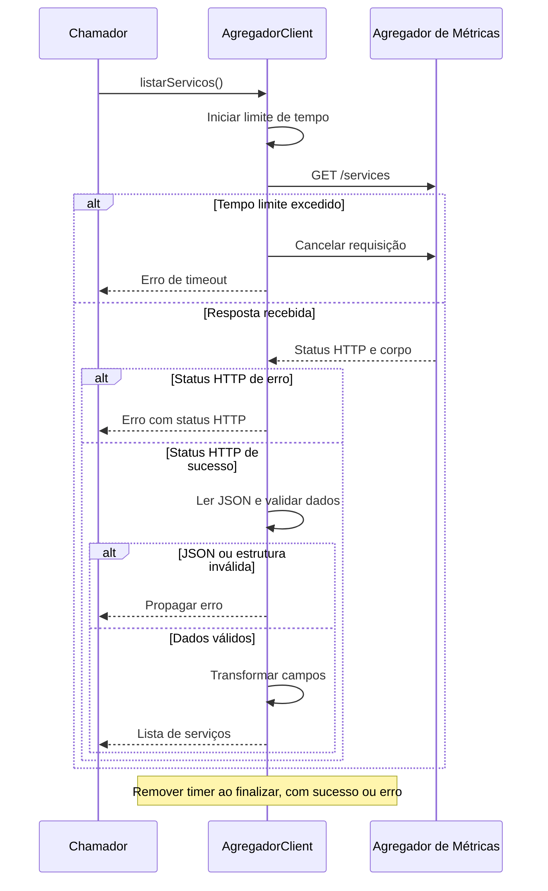

# Consulta de serviços no Agregador

O `AgregadorClient` consulta `GET /services`, verifica o status HTTP
e valida a estrutura da lista e os campos obrigatórios:
`id`, `name`, `metrics_path`, `location` e `location.region_code`.

Os dados são transformados para o formato interno do GreenER.
Uma lista vazia válida retorna `[]`. Falhas são propagadas ao chamador.

A consulta possui timeout configurável. Este fluxo ainda não
persiste os serviços nem executa a descoberta periodicamente.

## Configuração

| Variável | Finalidade |
|---|---|
| `AGREGADOR_BASE_URL` | Endereço base do Agregador. |
| `AGREGADOR_TIMEOUT_MS` | Timeout em milissegundos; padrão de 5000. |

## Validação

- Dez testes unitários do client.
- Um teste de disponibilização pelo módulo NestJS.
- Build do backend.

Os testes usam respostas HTTP simuladas e não comprovam
a disponibilidade da API externa.