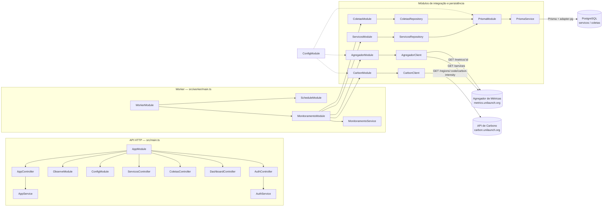
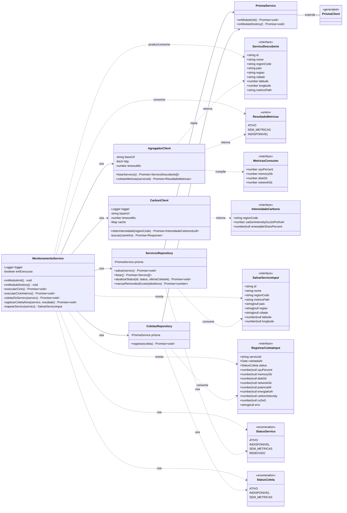
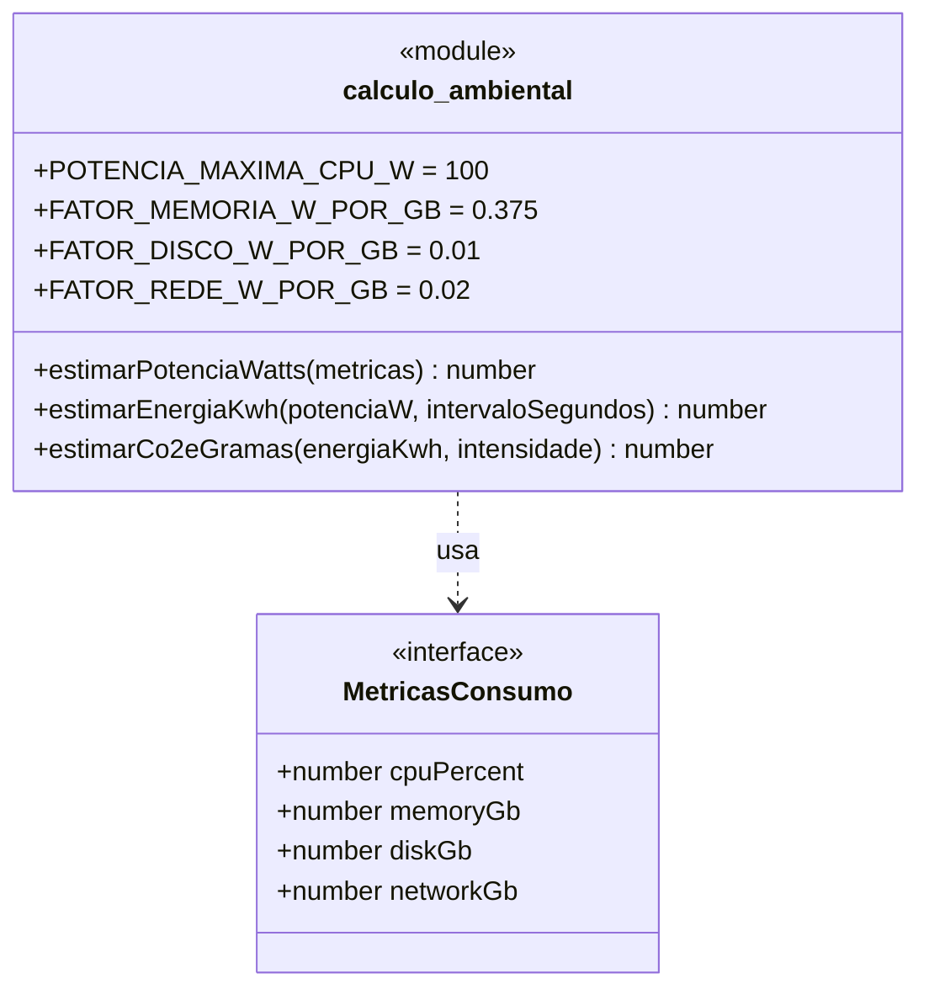
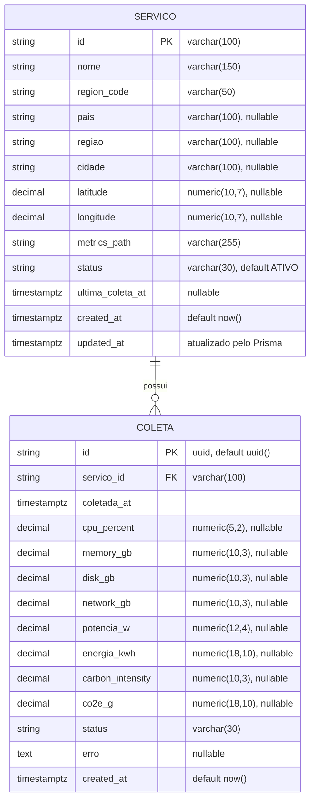
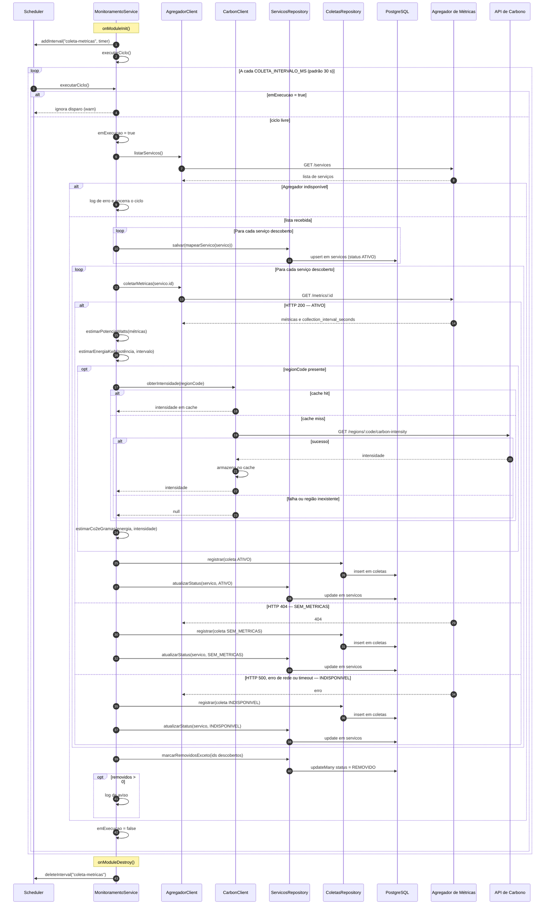

# UML do backend

Visão geral da estrutura do backend do GreenER, cobrindo os dois entrypoints
NestJS (API HTTP e Worker), as classes de domínio e integração, o modelo de
dados e o ciclo de coleta executado em background.

> Escopo: apenas o backend (`backend/`). O frontend e a infraestrutura do
> Docker Compose não fazem parte deste documento.

## 1. Componentes

O backend é composto por dois processos que compartilham o mesmo código e a
mesma camada de persistência:

- **API HTTP** (`src/main.ts`): cria o `AppModule`, habilita CORS e expõe a
  porta configurada. Serve o frontend com os endpoints de serviços, coletas,
  dashboard e autenticação.
- **Worker** (`src/worker/main.ts`): cria um contexto NestJS sem HTTP
  (`createApplicationContext`) com o `WorkerModule`, que registra o
  `MonitoramentoService` e o agendador.

O `AppModule` importa `ConfigModule`, `ObserveModule`, `AuthModule`,
`ServicosModule`, `ColetasModule` e `DashboardModule`. A descoberta de
serviços, a coleta e a persistência de métricas ficam no fluxo do Worker;
o backend apenas **lê** o que o Worker gravou.

### Responsabilidades dos componentes

| Componente | Responsabilidade |
|---|---|
| `AppModule` / `AppController` / `AppService` | API HTTP; `AppController` responde `GET /` com uma saudação. |
| `ServicosController` | `GET /servicos` e `GET /servicos/:id` (status, localização e última coleta). |
| `ColetasController` | `GET /coletas` com filtros `servicoId`, `de`, `ate` e `limit`. |
| `DashboardController` | `GET /dashboard/indicadores`, `/historico` e `/impacto-por-servico`. |
| `AuthController` / `AuthService` | `POST /auth/login` com JWT e verificação de senha via `bcryptjs`. |
| `WorkerModule` | Módulo raiz do processo de background, sem servidor HTTP. |
| `MonitoramentoService` | Orquestra descoberta, coleta, cálculos ambientais e persistência. |
| `AgregadorClient` | Consulta a lista de serviços e as métricas de cada serviço. |
| `CarbonClient` | Consulta a intensidade de carbono por região, com cache em memória. |
| `ServicosRepository` | Upsert dos serviços descobertos, atualização de status e remoção lógica. |
| `ColetasRepository` | Registro do histórico de coletas. |
| `PrismaService` | Conexão com o PostgreSQL via Prisma Client + `@prisma/adapter-pg`. |
| `ObserveModule` | Instrumentação e telemetria da API HTTP. |

---

## 2. Classes do backend

### Funções puras de domínio

O módulo `src/dominio/calculo-ambiental.ts` concentra as estimativas e não
possui I/O, o que permite testá-las isoladamente.

Regras aplicadas:

| Função | Fórmula |
|---|---|
| `estimarPotenciaWatts` | `(cpuPercent / 100) * 100 + memoryGb * 0.375 + diskGb * 0.01 + networkGb * 0.02` |
| `estimarEnergiaKwh` | `potenciaW * intervaloSegundos / 3600 / 1000` |
| `estimarCo2eGramas` | `energiaKwh * intensidadeCarbonoGco2ePorKwh` |

---

## 3. Modelo de dados (ER)

Observações do schema (`prisma/schema.prisma`):

- Tabelas mapeadas como `servicos` e `coletas`.
- Relação `Servico 1:N Coleta` com `onDelete: Cascade`.
- Índice composto `@@index([servicoId, coletadaAt])` em `Coleta`.
- `status` é armazenado como texto; os valores válidos vêm dos enums
  `StatusServico` e `StatusColeta` no domínio.

---

## 4. Sequência do ciclo de coleta

O `MonitoramentoService` registra um intervalo no `SchedulerRegistry` e
executa um ciclo imediatamente na inicialização. A flag `emExecucao` impede
que dois ciclos se sobreponham.

### Tratamento de erros e estados

| Situação | Coleta registrada | Status do serviço |
|---|---|---|
| Métricas obtidas (HTTP 200) | `ATIVO` com métricas, potência, energia e CO₂e | `ATIVO` |
| Serviço sem métricas (HTTP 404) | `SEM_METRICAS` | `SEM_METRICAS` |
| HTTP 500, erro de rede ou timeout | `INDISPONIVEL` | `INDISPONIVEL` |
| Serviço ausente na descoberta | Histórico preservado | `REMOVIDO` |
| Erro ao processar um serviço | — | O ciclo continua para os demais |
| Falha ao listar serviços | Nenhuma alteração no ciclo | — |

### Configuração relevante

| Variável | Uso |
|---|---|
| `COLETA_INTERVALO_MS` | Intervalo entre ciclos; padrão de 30 000 ms. |
| `AGREGADOR_BASE_URL` | Endereço base do Agregador de Métricas. |
| `AGREGADOR_TIMEOUT_MS` | Timeout das chamadas externas; padrão de 5 000 ms. |
| `CARBON_BASE_URL` | Endereço base da API de Carbono. |
| `DATABASE_URL` | Conexão do Prisma com o PostgreSQL. |
